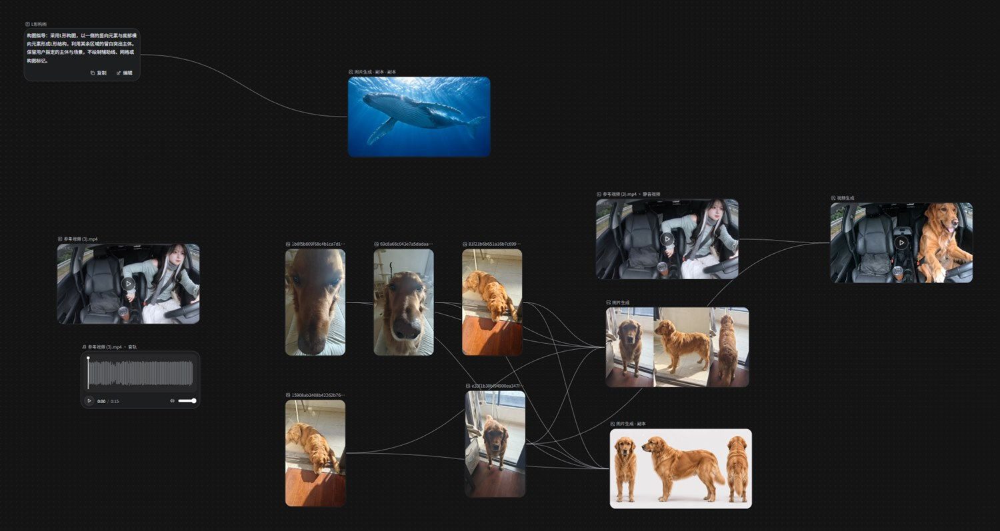
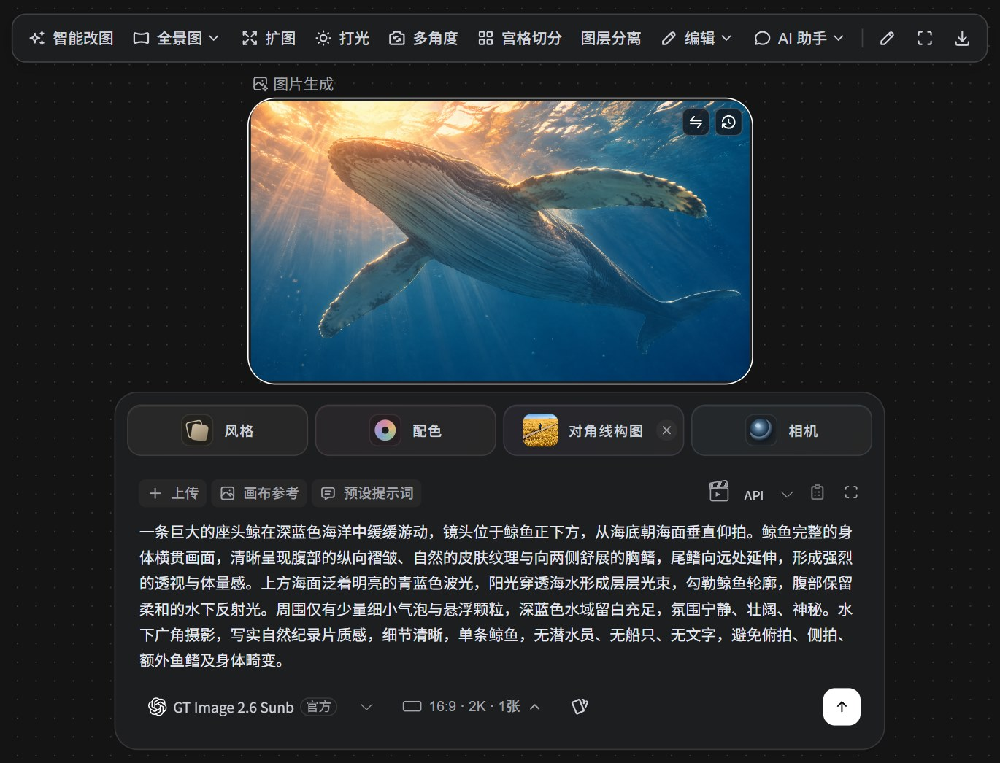
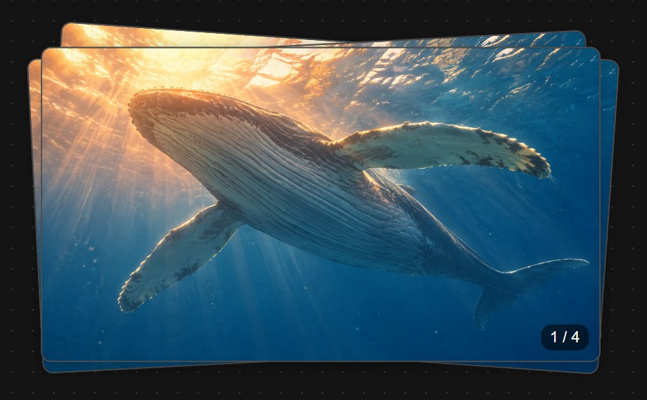
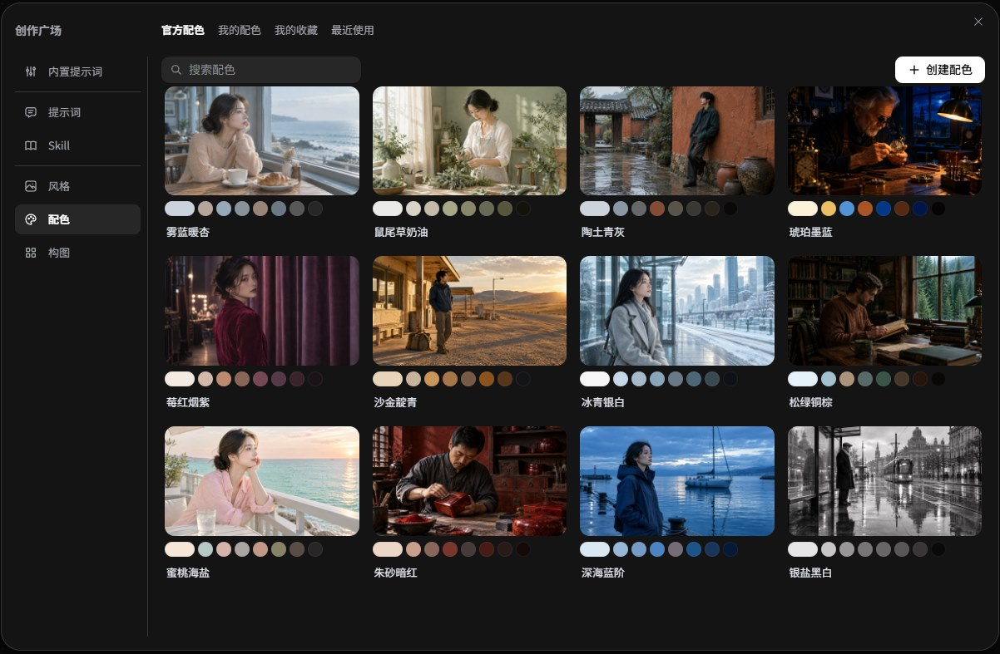
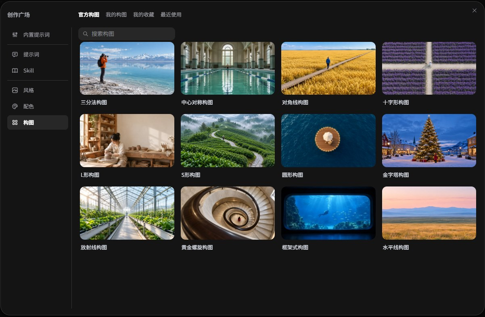

<p align="center">
  
</p>

<h1 align="center">见白画布</h1>

<p align="center">在一张无限画布上，把灵感、参考素材和 AI 生成结果连起来。</p>

<p align="center">
  <a href="https://github.com/lhlsp00114/jianbai/releases/latest"><strong>下载见白</strong></a>
  · <a href="#产品实拍">产品实拍</a>
  · <a href="#快速开始">快速开始</a>
  · <a href="./docs/development.md">开发文档</a>
</p>

<p align="center">
  <a href="https://github.com/lhlsp00114/jianbai/releases/latest"></a>
  <a href="./LICENSE"></a>
</p>



见白是一款基于 Toonflow 开发的开源 AI 创作工具。你可以把提示词、图片、视频和音频放在同一个项目里，用节点连线保留素材与结果之间的关系。生成一张图后，可以就地改图、比较多个版本，或把它接到下一个视频任务。

## 下载见白

打开 **[最新发布与安装包](https://github.com/lhlsp00114/jianbai/releases/latest)**，按系统选择对应文件。[历史版本](https://github.com/lhlsp00114/jianbai/releases)也可以在 GitHub Releases 中下载。

| 系统 | 安装包 |
| --- | --- |
| Windows | x64（Intel / AMD）或 ARM64，`.exe` |
| Linux（Debian / Ubuntu） | x64 或 ARM64，`.deb` |
| Android | ARM64，`.apk` |

macOS 暂未发布。手动安装时请选安装包，发布页的 `update.json` 和 `.tar.zst` 是桌面应用更新所用的文件。

## 产品实拍

以下为见白画布的实际界面，截图已裁切以突出对应功能。

### 图片生成和后续编辑

在同一个图片节点里填写提示词、添加参考图，选择模型、比例和生成数量。出图后可从节点工具栏继续扩图、打光、生成多角度或分离图层，支持的操作取决于所选工具和模型。



一次生成得到多张图时，可以在同一组里翻看不同结果，挑选合适的一张继续创作。



### 创作广场

用预设定下画面的风格、色调和构图。例如，先选「电影感」，再搭配「深海蓝阶」配色和对角线构图。常用方案可以收藏，下次直接复用。

| 风格 | 配色 | 构图 |
| --- | --- | --- |
| [](./docs/images/jianbaiStylePresets.jpg) | [](./docs/images/jianbaiColorPresets.jpg) | [](./docs/images/jianbaiCompositionPresets.jpg) |

点击截图可查看大图。

### 还能在画布里做什么

- **图层编辑**：在图层分离节点里调整位置、堆叠顺序和显隐，再合并结果或导出 PSD。
- **分镜与白模预演**：用 TrumanMap 搭建场景、布置人物、规划机位，再开始正式生成。
- **Agent 与 MCP**：让画布助手参考当前素材来整理提示词，也可按需连接外部工具。
- **项目与素材管理**：把参考素材、生成结果和节点关系保存在所选工作区，方便下次打开继续做。

## 快速开始

1. 从发布页下载对应安装包，打开见白。首次启动可以选择「稍后配置」，直接进入。
2. 新建项目并选择工作区目录，再打开一张无限画布。
3. 添加一个图片生成节点，填入提示词或选取参考图。调用在线模型前，在设置里配置见白 API 密钥或相应的模型供应商。
4. 生成结果回到画布后，可以接着编辑，或连接到下一个节点作为参考素材。

## 从源码运行

项目使用 Bun、Vue 3、TypeScript 和 Express。

```bash
bun install
bun run dev:plugins
bun run dev
```

Web 开发入口为 `http://localhost:5173`。完整的环境要求、插件构建和桌面打包步骤见[开发文档](./docs/development.md)。

## 开源与致谢

见白基于 [Toonflow](https://github.com/HBAI-Ltd/Toonflow-app) 开发。感谢 Toonflow 的原作者、维护者及社区贡献者，也感谢 [PhotoCraft](https://github.com/storytold/photocraft) 和其他开源依赖的作者。

项目采用 [MIT 许可证](./LICENSE)。第三方组件及其素材遵循各自的许可证与使用条款。
