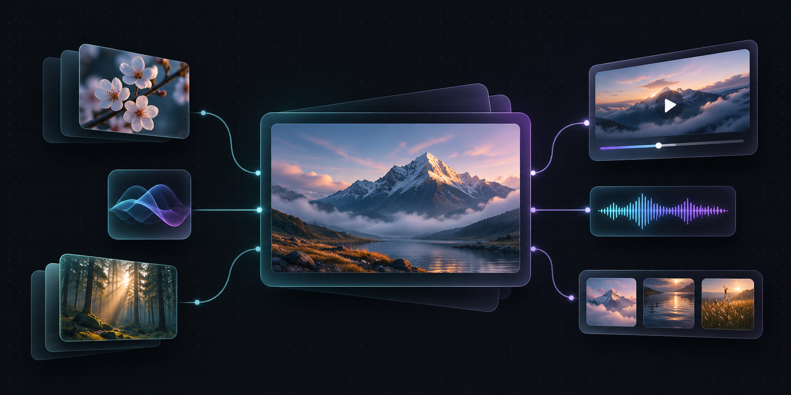
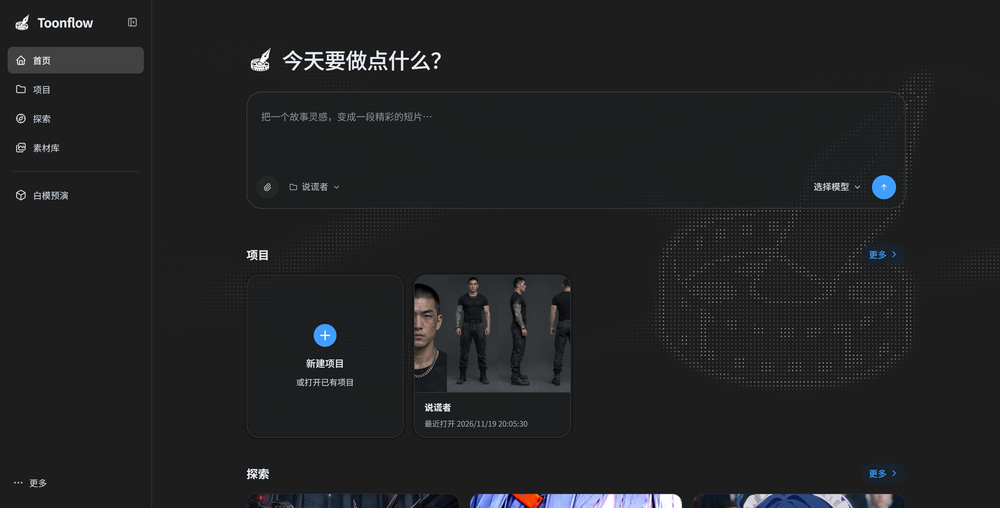
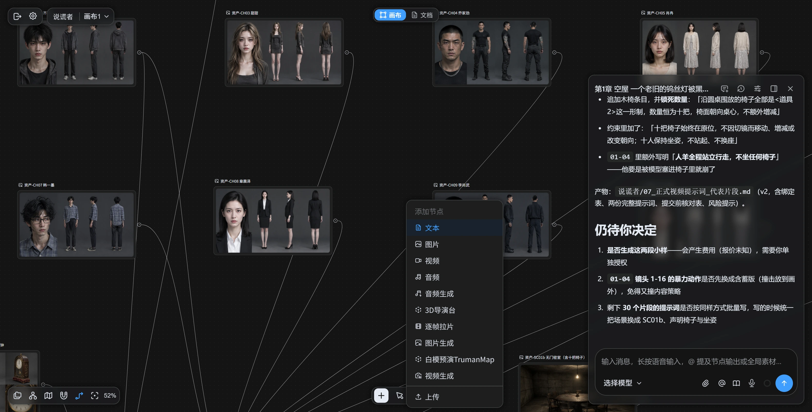
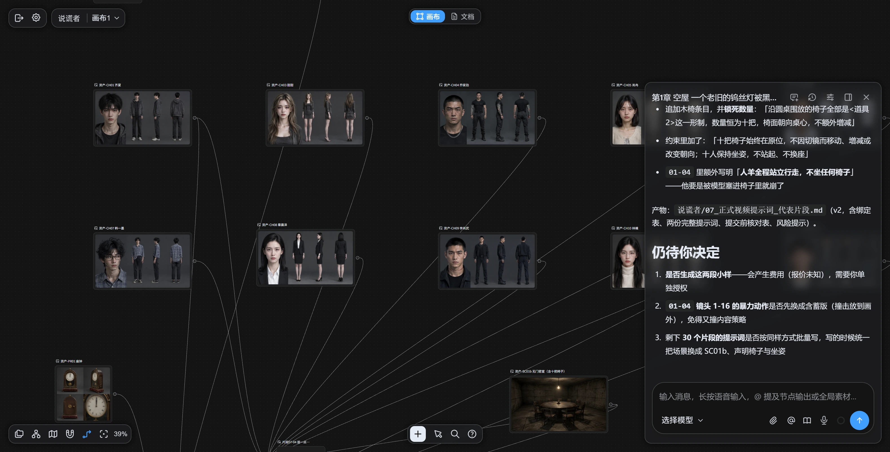
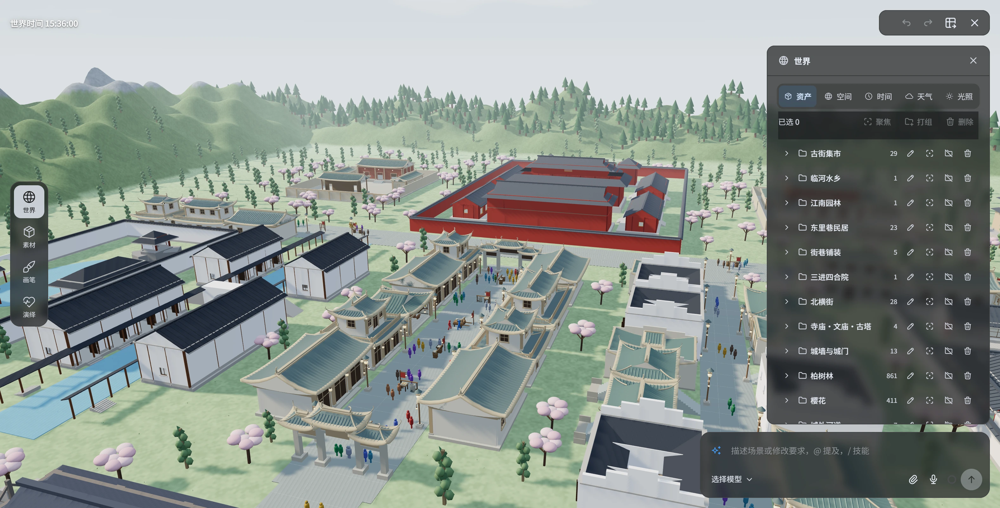
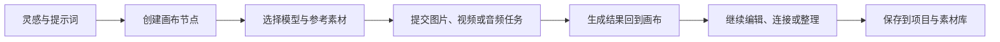

# 见白 · Toonflow

见白是一款基于 Toonflow 开发的 AI 内容创作画布，面向图片、视频、音频、文本和视觉设计等创作场景。

它把无限画布、节点工作流、AI 生成、素材管理、创作广场、Agent 助手、MCP 工具、图像编辑和白模预演整合到同一个工作区中。用户可以将提示词、参考素材、生成参数、生成结果和后续编辑串联起来，形成清晰、可保存、可继续修改的创作流程。

见白保留 Toonflow 的节点系统、插件体系和扩展能力，并围绕中文用户体验、画布交互、模型接入和 AI 创作流程进行持续开发。项目适合个人创作者、设计师、视频制作者、漫画创作者以及需要使用 AI 完成视觉内容生产的团队。

这是基于 [Toonflow 上游开源项目](https://github.com/HBAI-Ltd/Toonflow-app) 开发的个人版本，当前版本为 `1.0.0`。

<p>
  <a href="https://github.com/lhlsp00114/jianbai">
    
  </a>
  <a href="https://github.com/lhlsp00114/jianbai/releases">
    
  </a>
  
  
</p>

<p align="center">
  
</p>

> 见白把灵感、素材、模型和生成结果放在同一张画布上，让 AI 创作从一次性生成变成可以继续编辑、连接和沉淀的工作流。

## 产品预览

见白的核心入口是一张可自由组织的创作画布。用户可以从节点菜单添加内容，也可以把生成结果、参考素材和后续编辑放在同一条创作链路中。

<p align="center">
  
  
</p>

| 画布创作 | 节点工作流 |
| --- | --- |
| 通过无限画布组织图片、文本、视频、音频和生成任务。 | 将提示词、参考图、模型、参数和结果连接成可追踪流程。 |

<p align="center">
  
  
</p>

| 节点菜单 | 素材管理 |
| --- | --- |
| 按创作任务快速添加图片、视频、音频、脚本和其他工具节点。 | 在项目工作区内管理素材，继续使用已有内容完成后续创作。 |

<p align="center">
  
  
</p>

| Agent 协作 | 多媒体生成 |
| --- | --- |
| 让 Agent 理解画布上下文，辅助查询节点、整理工作区和推进创作任务。 | 通过节点调用图像、视频等模型，将生成结果直接留在画布中。 |

<p align="center">
  
  
</p>

| 场景预演 | 镜头规划 |
| --- | --- |
| 在正式生成前搭建场景、角色和空间关系。 | 用时间轴和镜头视图整理叙事节奏与画面结构。 |

## 一次创作如何进行



1. 在无限画布中创建一个图片、视频、音频、文本或工具节点。
2. 输入提示词，添加参考图或工作区素材，并选择合适的模型和参数。
3. 提交生成任务，等待结果回到对应节点，保留输入和输出的关系。
4. 对结果继续编辑、生成变体、连接到其他节点，或交给 Agent 继续处理。
5. 将阶段性结果保存到项目目录和素材库，后续可以继续打开和复用。

## 节点能力

见白将不同创作阶段拆成独立节点，节点可以单独使用，也可以通过连线组成工作流。

| 节点类别 | 主要用途 |
| --- | --- |
| 文本节点 | 保存创意、脚本、提示词、说明和创作过程中的文字资料。 |
| 图片生成节点 | 使用文字和参考素材生成图片，保存模型与参数信息。 |
| 图片节点 | 查看、整理、编辑和继续使用已有图片。 |
| 图层分离节点 | 将一次生成返回的多张图层作为一个可编辑对象管理，并支持后续调整和合并。 |
| 图片对比节点 | 对比多个图片结果，辅助筛选和整理版本。 |
| 视频生成节点 | 使用图片、文字或参考素材创建视频生成任务。 |
| 视频节点 | 管理视频结果并连接到后续创作步骤。 |
| 音频生成节点 | 创建配音、音乐或其他音频生成任务。 |
| 音频节点 | 保存和继续使用音频素材。 |
| 脚本生成器 | 辅助整理故事、脚本和内容结构。 |
| 3D 导演台 | 使用 TrumanMap 进行场景搭建、镜头规划和白模预演。 |
| 手绘画板 | 通过绘制内容补充草图、构图和创作参考。 |

## 创作数据如何组织

见白把创作内容分为画布、节点、素材和生成记录几个层次。

- 画布保存项目中的整体布局、节点关系和创作阶段。
- 节点保存提示词、参考素材、模型配置、生成状态和结果。
- 素材库保存可以跨项目复用的图片、视频、音频和其他文件。
- 历史记录保存生成任务和节点操作，方便查找最近内容并继续处理。
- 工作区文件使用用户选择的项目目录，便于备份、迁移和版本管理。

## Agent 与 MCP 的协作方式

Agent 可以理解当前工作区和画布上下文，并在用户授权范围内辅助完成创作操作。MCP 为外部 Coding 工具和 Agent 提供连接入口，使它们能够按需查询和操作见白中的能力。

常见协作流程如下。

1. 在见白中打开 Agent 或启用 MCP 服务。
2. 通过工作区和画布上下文，让 Agent 获取当前项目所需的信息。
3. Agent 查询可用节点工具，再执行读取、创建、移动、重命名、连接或整理等操作。
4. 画布通过现有的节点校验、保存和历史机制完成变更。

MCP 支持 HTTP 和 stdio 配置方式。服务默认在本地运行，连接状态、访问凭证和工具权限由设置页面管理。外部工具是否能够操作画布，取决于当前连接配置和用户实际启用的能力。

## 适合谁使用

### 个人创作者

适合把提示词、参考图、生成结果和修改过程集中管理，减少素材散落在不同软件和文件夹中的情况。

### 设计师和视觉创作者

适合进行角色、场景、风格、构图和多版本方案整理，也适合把生成结果交给图像编辑器继续处理。

### 视频和漫画创作者

适合从脚本、角色、场景、分镜到视频和白模预演逐步推进，保留每个阶段的素材和上下文。

### 需要自动化协作的团队

适合通过 Agent、MCP 和节点工具连接外部工作流，把重复的画布整理、素材管理和创作操作交给工具完成。

## 设计方向

见白围绕几个方向持续开发。

- 用画布承载完整创作过程，而不是只保存最终结果。
- 用节点降低多模型、多素材和多阶段任务之间的切换成本。
- 用工作区文件和历史记录保证内容可继续、可整理、可迁移。
- 用 Agent 和 MCP 扩展画布的自动化能力，同时保留明确的权限边界。
- 用中文界面和轻量交互降低 AI 创作工具的使用门槛。

## 项目优势

### 可视化的 AI 创作流程

见白使用无限画布和节点来组织创作。图片、视频、音频、文本、参考素材和生成任务都可以放在同一个空间中，创作者可以直接看到内容之间的关系，减少在多个页面和工具之间来回切换。

### 从灵感到结果的连续工作区

提示词、模型、参考图、生成参数和生成结果可以保留在对应节点中。创作者可以从一个结果继续编辑、生成或连接到下一个节点，让一次性操作变成可追踪、可复用的创作流程。

### 多种模型和供应商接入

见白支持多家模型供应商和自定义 API。不同模型可以根据图片、视频、文本或其他创作任务分别配置，方便在效果、速度、成本和使用习惯之间进行选择。

### 节点化的内容管理

节点不仅用于生成内容，也用于保存创作上下文。用户可以整理、复制、重命名、连接和移动节点，并通过画布历史继续撤销和恢复操作。复杂项目可以按照角色、场景、镜头、素材和生成阶段进行拆分。

### Agent 与 MCP 协作

见白提供 Agent 和 MCP 能力。外部 Coding 工具和 Agent 在获得授权后，可以读取工作区状态、查询画布节点、操作画布、调用节点工具和管理部分创作流程。画布操作会通过宿主提供的实时能力执行，保持节点校验、历史记录和工作区状态的一致性。

### 项目和素材统一保存

项目、画布、节点数据和相关素材保存在用户选择的工作区目录中。创作内容具有明确的项目归属，便于整理、备份、迁移和长期维护，也方便在同一项目中继续之前的工作。

### 创作资源可以沉淀复用

创作广场支持提示词、Skill、风格、配色和构图等内容。用户可以保存自己的创作方案，管理收藏和最近使用记录，并将选中的内容直接发送到画布或生成节点中。

### 面向多阶段内容生产

见白适合单次创作，也适合角色设计、场景设计、分镜规划、图片编辑、视频制作、漫画制作和多阶段视觉内容生产。不同阶段可以通过节点连接起来，保留从输入到结果的完整过程。

## 当前功能

### 无限画布

- 通过节点组织图片、文字、视频、音频和 AI 生成内容
- 支持节点列表、素材库、缩放菜单、网格吸附和小地图
- 支持节点整理、复制、移动、连接、重命名和批量操作
- 支持画布撤销、重做、历史记录和快捷操作
- 图片节点可以发送到 Agent 或 Eagle

### AI 创作

- 支持图片生成、图片编辑、视频生成和文本创作节点
- 支持多家模型供应商和自定义 API
- 支持参考图、提示词、模型和生成参数管理
- 创作广场包含提示词、Skill、风格、配色和构图
- 风格、配色和构图支持官方内容、我的内容、收藏和最近使用
- 选择创作内容后可以直接发送到画布

### Agent 与 MCP

- 支持见白 Agent 对话和画布协作
- 支持通过 MCP 连接外部 Coding 工具和 Agent
- 支持读取工作区、查询画布状态和调用节点工具
- 支持 HTTP 和 stdio 配置方式
- MCP 连接受本地服务开关和访问凭证保护

### 首页与项目

- 首页统一管理项目、无限画布、无限漫画和探索内容
- 工作区文件保存在用户选择的目录中
- 支持项目打开、新建、重命名和导出
- 支持素材库和工作区文件管理
- 支持生成记录和节点历史查看

### 图像编辑

- 集成开源 PhotoCraft Web 图像编辑器
- 支持在首页打开图像编辑页面
- 支持导出 PSD
- PhotoCraft 相关代码和许可证以 [上游项目](https://github.com/storytold/photocraft) 为准

### 白模预演

- TrumanMap 支持场景搭建、镜头预演、人物走位和时间轴查看
- 支持从画布和创作流程进入白模预演
- 适合在正式生成前整理场景、镜头和叙事结构

## 适用场景

- AI 图片和视频创作
- 角色、场景和视觉素材设计
- 分镜和漫画前期规划
- 多模型生成结果对比与整理
- 参考图、提示词和生成结果的长期管理
- 需要 Agent 或外部工具参与的创作流程
- 需要保留完整创作过程的个人项目和小型团队项目

## 快速开始

### 开发环境

项目使用 Bun、TypeScript、Vue 3 和 Express。

```bash
bun install
bun run dev:plugins
bun run dev
```

开发服务器启动后访问 `http://localhost:3000`。

### Windows 预览启动

双击项目根目录的 `previewToonflow.bat`。脚本会构建插件和 Web 前端，然后启动本地服务。

### 构建检查

```bash
bun run --filter '@toonflow/web' typecheck
bun run --filter '@toonflow/web' build
bun run --filter '@toonflow/server' typecheck
```

## 项目结构

```text
apps/web                 Web 前端和首页
apps/server              本地服务和 API
packages/nodeShared      节点共享组件和创作数据
packages/nodes            图片、视频、文本等节点
packages/providers        模型供应商适配
packages/tools            画布工具和工作区工具
```

## 更新

项目保留官方源和 GitHub 两种更新来源。正式发布时，个人版本的安装包和版本信息发布到个人 GitHub Releases。

个人仓库地址为 [lhlsp00114/jianbai](https://github.com/lhlsp00114/jianbai)。

## 上游项目与许可

本项目基于 [HBAI-Ltd/Toonflow-app](https://github.com/HBAI-Ltd/Toonflow-app) 开发，保留上游项目的开源说明、第三方依赖许可和版权信息。

项目整体使用 [MIT License](./LICENSE)。PhotoCraft 使用其自身的 MIT / Apache-2.0 双许可证。第三方依赖、图标、图片和模型遵循各自的许可证与使用条款。

## 致谢

- 感谢 Toonflow 上游项目及其贡献者
- 感谢 PhotoCraft 项目及其贡献者
- 感谢所有开源依赖和模型服务提供方
- 感谢使用、反馈和帮助完善见白的用户
